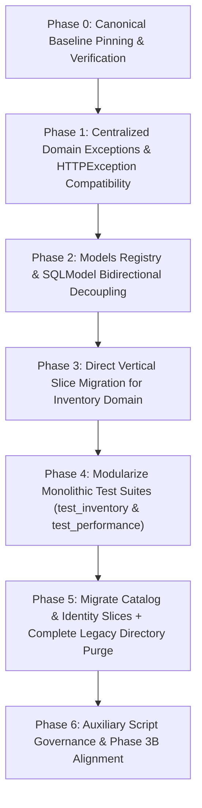

# Backend Refactoring Plan: Modular Architecture & 250 LOC Compliance

> **Document Status**: Revised Post-Adversarial Architectural Review (All Blockers & Traps Resolved)  
> **Author**: Antigravity  
> **Date**: 2026-10-26 (Revised)  
> **Governing Standards**: [`AGENTS.md`](../AGENTS.md) (Section 6: Backend Architecture & Async SQLModel Contract; Section 6.B: The 250 LOC Backend Blueprint)

---

## 1. Executive Summary & LOC Inventory

This document defines an end-to-end, phased refactoring plan to eliminate all line-of-code (LOC) violations in the Vitalcer backend. It enforces the architectural contract established in [`AGENTS.md`](../AGENTS.md) Section 6: **no single Python file under `server/` may exceed 250 lines of code**.

Following the adversarial review, this revised plan completely eliminates intermediate "zombie shims", migrates directly to vertical domain slices (`server/modules/{catalog, inventory, identity}/`), decouples bidirectional SQLModel relationships via a centralized registry, prevents exception payload/status-code drift, and splits write operations into `movements.py` and `pos_fulfillment.py` so **every single backend file stays strictly under 140 LOC** (well below the 160 LOC target and 250 LOC hard ceiling).

### 1.1 Complete Python Codebase LOC Audit

```
┌────────────────────────────────────────────────────────────────────────┐
│                        PYTHON LOC AUDIT MATRIX                         │
├────────────────────────────────┬─────┬───────────┬─────────────────────┤
│ File Path                      │ LOC │ Status    │ Tier Classification │
├────────────────────────────────┼─────┼───────────┼─────────────────────┤
│ server/services/inventory_...  │ 301 │ VIOLATION │ Tier 1: Core Server │
│ server/api/v1/endpoints/inv... │ 222 │ HOTSPOT   │ Tier 1: Core Server │
│ server/schemas/inventory.py    │ 133 │ OK        │ Tier 1: Core Server │
│ server/api/v1/endpoints/prod...│ 123 │ OK        │ Tier 1: Core Server │
│ server/schemas/products.py     │  88 │ OK        │ Tier 1: Core Server │
│ server/api/v1/endpoints/use... │  82 │ OK        │ Tier 1: Core Server │
│ server/utils/barcode.py        │  69 │ OK        │ Tier 1: Core Server │
│ server/core/db.py              │  64 │ OK        │ Tier 1: Core Server │
│ server/models/products.py      │  53 │ OK        │ Tier 1: Core Server │
│ server/main.py                 │  48 │ OK        │ Tier 1: Core Server │
│ server/models/inventory_led... │  41 │ OK        │ Tier 1: Core Server │
│ server/services/users_servi... │  33 │ OK        │ Tier 1: Core Server │
│ server/schemas/users.py        │  28 │ OK        │ Tier 1: Core Server │
│ server/core/config.py          │  24 │ OK        │ Tier 1: Core Server │
│ server/models/users.py         │  20 │ OK        │ Tier 1: Core Server │
│ server/core/dependencies.py    │  15 │ OK        │ Tier 1: Core Server │
├────────────────────────────────┼─────┼───────────┼─────────────────────┤
│ tests/test_inventory_engine.py │ 333 │ VIOLATION │ Tier 2: Test Suite  │
│ tests/test_n_plus_one.py       │ 286 │ VIOLATION │ Tier 2: Test Suite  │
│ tests/test_users_endpoints.py  │ 191 │ OK        │ Tier 2: Test Suite  │
│ tests/test_models.py           │ 182 │ OK        │ Tier 2: Test Suite  │
│ tests/test_products_endpoint...│ 166 │ OK        │ Tier 2: Test Suite  │
│ tests/test_users_services.py   │ 113 │ OK        │ Tier 2: Test Suite  │
│ tests/conftest.py              │ 100 │ OK        │ Tier 2: Test Suite  │
│ tests/test_double_db.py        │  69 │ OK        │ Tier 2: Test Suite  │
│ tests/test_postgre_config.py   │  60 │ OK        │ Tier 2: Test Suite  │
│ tests/test_barcode.py          │  51 │ OK        │ Tier 2: Test Suite  │
├────────────────────────────────┼─────┼───────────┼─────────────────────┤
│ scripts/spike_remito_vision.py │ 906 │ VIOLATION │ Tier 3: Aux Scripts │
│ scripts/windows/vitalcer_con...│ 474 │ VIOLATION │ Tier 3: Aux Scripts │
│ scripts/windows/service_man... │ 413 │ VIOLATION │ Tier 3: Aux Scripts │
│ scripts/api_export.py          │  20 │ OK        │ Tier 3: Aux Scripts │
└────────────────────────────────┴─────┴───────────┴─────────────────────┘
```

### 1.2 Target Post-Refactor Profile

| Component | Pre-Refactor Maximum | Post-Refactor Maximum | Architecture & Guarantees |
| :--- | :--- | :--- | :--- |
| **`server/` Runtime Code** | 301 LOC (`inventory_services.py`) | **< 140 LOC** | Direct vertical domain slices (`server/modules/`), write path split (`movements.py` + `pos_fulfillment.py`), read path split (`queries.py`), thin routers, centralized domain exceptions |
| **`tests/` Test Suites** | 333 LOC (`test_inventory_engine.py`) | **< 120 LOC** | Modular test packages grouped by subdomain (`tests/inventory/`, `tests/performance/`) |
| **`scripts/` Tooling** | 906 LOC (`spike_remito_vision.py`) | Isolated / Modularized | Classified as standalone spike; roadmap mapped to Phase 3B modules |

---

## 2. Invariants & Architectural Blueprint

All refactoring actions must adhere to the following non-negotiable invariants:

### 2.1 The 250 LOC Backend Blueprint ([`AGENTS.md`](../AGENTS.md) Section 6.B)
* **Split Read/Write Paths**: Write mutations and read projections are strictly separated. Furthermore, write operations are split by subdomain (`movements.py` for receiving/merma/adjustments, `pos_fulfillment.py` for reservations/dispatch/POS sales) to avoid ceiling risk.
* **Extract Query Builders**: Complex SQL joins, aggregations (`SUM`), and ledger balance projections belong in `queries.py`, never inline in endpoints.
* **Thin Routers**: Routers are pure HTTP coordinators. Endpoints parse request models, call service/engine functions, translate domain exceptions to HTTP status codes via global handlers, and return response schemas. Zero business logic or raw SQL execution inside `router.py`.

### 2.2 Async MVCC & Double-Entry Invariants ([`AGENTS.md`](../AGENTS.md) Section 6.C)
* **Zero Direct Balance Overwrites**: Physical stock is never altered without an append-only `InventoryLedger` row in the exact same database transaction.
* **Deterministic Deadlock Prevention**: Batch operations (e.g. `record_pos_batch_sale`) must sort product IDs deterministically (`sorted(item_totals.keys())`) prior to row-locking with `with_for_update()`.
* **Zero N+1 Query Regressions**: All queries fetching products for stock mutation must use `.options(noload("*"))` to prevent eager-loading entire ledger histories.
* **Whole ARS Integer Currency**: All prices, totals, and adjustments remain whole integers. Zero cents or float currency math.

### 2.3 SQLModel Cross-Slice Relationship Decoupling
* When models in different vertical slices reference each other (e.g. `Product` in `server/modules/catalog/models.py` and `InventoryLedger` in `server/modules/inventory/models.py`):
  * Relationships use string forward references: `Relationship(back_populates="product", sa_relationship_kwargs={"lazy": "selectin"})`.
  * Type annotations use `if TYPE_CHECKING:` guards to prevent circular import errors at runtime.
  * A centralized registry [`server/core/models_registry.py`](file:///home/brian/dev/server/core/models_registry.py) imports all module models in deterministic order on startup, ensuring SQLAlchemy mappers and `Base.metadata` are fully populated.

### 2.4 Error Response Payload & Status Code Integrity
* Custom exception handlers must emit `{"detail": exc.message}` strictly. Under no circumstances may custom fields (`code`, `error_type`) replace or wrap `detail`, preserving 100% compatibility with FastAPI's default `HTTPException` serialization and existing frontend/test assertions.
* Exception parameters `requested` and `available` are typed as `int | float` to support both discrete unit quantities and continuous bulk weight measurements without type-check errors.

### 2.5 Zero-Drift OpenAPI Contract
* Moving code or restructuring routers must produce **zero changes** in the public OpenAPI schema (`scripts/openapi.json`), verified via canonical key-sorted JSON diff (`jq -S . scripts/openapi.json | sha256sum`).

---

## 3. Phase-by-Phase Execution Plan



---

### Phase 0: Baseline Pinning & Pre-flight Verification

Before touching source files:
1. Run complete verification gates:
   ```bash
   make lint
   make typecheck
   make test
   make openapi
   ```
2. Capture canonical key-sorted OpenAPI baseline checksum:
   ```bash
   jq -S . scripts/openapi.json | sha256sum > /tmp/openapi_canonical_baseline.sha256
   ```
3. Record current test passing count (82 passed in ~6.4s).

---

### Phase 1: Centralized Domain Exceptions & HTTPException Compatibility

#### Problem & Rationale
Currently, [`server/api/v1/endpoints/inventory.py`](file:///home/brian/dev/server/api/v1/endpoints/inventory.py) (222 LOC) contains 8 repetitive `try...except ValueError` blocks converting generic Python exceptions to HTTP status codes.

#### Audit of Existing Endpoint Status Codes & Tests
A complete audit of `inventory.py` and `tests/test_inventory_engine.py` reveals:
* Missing entities raise `ValueError("... not found")` -> mapped to **HTTP 404**.
* Stock exhaustion / validation failures raise `ValueError("Cannot log merma...", "Physical stock depleted...", "Insufficient virtual stock...")` -> mapped to **HTTP 400**.
* Tests explicitly assert `assert resp.status_code == 400` and `"Cannot log merma" in resp.json()["detail"]` or `"Physical stock depleted" in resp.json()["detail"]`.

#### Actionable Steps
1. Create [`server/core/exceptions.py`](file:///home/brian/dev/server/core/exceptions.py) (**~70 LOC**):
   ```python
   from fastapi import FastAPI, Request, status
   from fastapi.responses import JSONResponse


   class VitalcerException(Exception):
       """Base domain exception for all Vitalcer business errors."""

       def __init__(self, message: str):
           super().__init__(message)
           self.message = message


   class EntityNotFoundError(VitalcerException):
       """Raised when an entity cannot be found (maps to HTTP 404)."""

       def __init__(self, entity: str, identifier: str | int):
           super().__init__(f"{entity} with ID {identifier} not found")
           self.entity = entity
           self.identifier = identifier


   class InsufficientStockError(VitalcerException):
       """Raised when physical stock is insufficient (maps to HTTP 400)."""

       def __init__(self, item_name: str, requested: int | float, available: int | float):
           super().__init__(
               f"Physical stock depleted for '{item_name}': "
               f"requested {requested}, available {available}"
           )
           self.item_name = item_name
           self.requested = requested
           self.available = available


   class InsufficientVirtualStockError(VitalcerException):
       """Raised when virtual delivery stock is insufficient (maps to HTTP 400)."""

       def __init__(self, requested: int | float, available: int | float):
           super().__init__(
               f"Insufficient virtual stock for reservation. "
               f"Available: {available}, Requested: {requested}"
           )
           self.requested = requested
           self.available = available


   class InvalidMovementError(VitalcerException):
       """Raised on invalid shrinkage or adjustment rules (maps to HTTP 400)."""

       def __init__(self, message: str):
           super().__init__(message)


   def register_exception_handlers(app: FastAPI) -> None:
       """Register global exception handlers preserving standard {'detail': str} format."""

       @app.exception_handler(EntityNotFoundError)
       async def entity_not_found_handler(_: Request, exc: EntityNotFoundError):
           return JSONResponse(
               status_code=status.HTTP_404_NOT_FOUND,
               content={"detail": exc.message},
           )

       @app.exception_handler(InsufficientStockError)
       async def insufficient_stock_handler(_: Request, exc: InsufficientStockError):
           return JSONResponse(
               status_code=status.HTTP_400_BAD_REQUEST,
               content={"detail": exc.message},
           )

       @app.exception_handler(InsufficientVirtualStockError)
       async def insufficient_virtual_stock_handler(
           _: Request, exc: InsufficientVirtualStockError
       ):
           return JSONResponse(
               status_code=status.HTTP_400_BAD_REQUEST,
               content={"detail": exc.message},
           )

       @app.exception_handler(InvalidMovementError)
       async def invalid_movement_handler(_: Request, exc: InvalidMovementError):
           return JSONResponse(
               status_code=status.HTTP_400_BAD_REQUEST,
               content={"detail": exc.message},
           )

       @app.exception_handler(VitalcerException)
       async def general_domain_handler(_: Request, exc: VitalcerException):
           return JSONResponse(
               status_code=status.HTTP_400_BAD_REQUEST,
               content={"detail": exc.message},
           )
   ```

2. Hook `register_exception_handlers(app)` into [`server/main.py`](file:///home/brian/dev/server/main.py).

#### Verification Gate
* `make typecheck` && `make test`: All 82 tests must pass with zero regression in status codes or `detail` payloads.

---

### Phase 2: Models Registry & SQLModel Bidirectional Decoupling

#### Problem & Rationale
`Product` and `InventoryLedger` have bidirectional SQLModel `Relationship()` fields:
* `Product.ledger_entries`: `Relationship(back_populates="product", sa_relationship_kwargs={"lazy": "selectin"})`
* `InventoryLedger.product`: `Relationship(back_populates="ledger_entries", sa_relationship_kwargs={"lazy": "selectin"})`

Splitting these tables into separate domain modules (`server/modules/catalog/models.py` and `server/modules/inventory/models.py`) without proper decoupling will cause circular import failures or uninitialized mapper errors.

#### Actionable Steps
1. Create [`server/core/models_registry.py`](file:///home/brian/dev/server/core/models_registry.py) (**~20 LOC**):
   ```python
   """Central registry importing all SQLModel table classes.

   Ensures SQLAlchemy metadata is fully populated and bidirectional
   Relationship back_populates mappers resolve cleanly across slices.
   """

   # Import tables in dependency order
   import server.models.inventory_ledger  # noqa: F401
   import server.models.products  # noqa: F401
   import server.models.users  # noqa: F401
   ```
2. Update [`server/main.py`](file:///home/brian/dev/server/main.py) and [`tests/conftest.py`](file:///home/brian/dev/tests/conftest.py) to import `server.core.models_registry` instead of `server.models`.
3. In all model classes, verify:
   * Foreign keys use table string names: `foreign_key="products.id"`.
   * Relationships use string references for `back_populates`: `"product"` and `"ledger_entries"`.
   * Type annotations use string forward references (`list["InventoryLedger"]`, `Optional["Product"]`) guarded by `if TYPE_CHECKING:`.

#### Verification Gate
* `make test`: Confirms `test_n_plus_one.py` (`test_products_to_ledger_selectin_loading` and `test_ledger_to_product_selectin_loading`) passes cleanly.

---

### Phase 3: Direct Vertical Slice Migration for Inventory Domain

#### Problem & Rationale
Rather than creating intermediate files in `server/services/` that must be moved again later (the "zombie shim" anti-pattern), the inventory domain is migrated **directly** into its final vertical slice destination: [`server/modules/inventory/`](file:///home/brian/dev/server/modules/inventory/).

To prevent ceiling risk and guarantee every file stays below the **< 140 LOC target**, write operations are split into:
1. `movements.py` (~95 LOC): Inbound receiving, shrinkage merma, physical adjustment.
2. `pos_fulfillment.py` (~100 LOC): Virtual reservations, releases, dispatch fulfillment, in-store POS sales, and batch atomic checkout.
3. `queries.py` (~60 LOC): Historical projections and drift reconciliation.
4. `router.py` (~130 LOC): Thin HTTP coordinator.

```
server/modules/inventory/
├── __init__.py               # Exports public package symbols (~10 LOC)
├── models.py                 # InventoryLedger table model (~41 LOC)
├── schemas.py                # Movement payloads & response DTOs (~133 LOC)
├── movements.py              # Inbound replenishment, merma, stock adjustment (~95 LOC)
├── pos_fulfillment.py        # Reservations, fulfillments, single & batch POS (~100 LOC)
├── queries.py                # Stock drift audit & paginated ledger history (~60 LOC)
└── router.py                 # Thin HTTP coordinator routing to handlers (~130 LOC)
```

#### Actionable Steps
1. Create `server/modules/inventory/`:
   * Move `server/models/inventory_ledger.py` -> `server/modules/inventory/models.py`.
   * Move `server/schemas/inventory.py` -> `server/modules/inventory/schemas.py`.
2. Extract write paths from `server/services/inventory_services.py`:
   * `server/modules/inventory/movements.py` (**~95 LOC**):
     * `_get_locked_product(db: AsyncSession, product_id: int) -> Product`
     * `receive_stock(db: AsyncSession, req: StockReceivingRequest) -> InventoryLedger`
     * `log_merma(db: AsyncSession, req: ShrinkageMermaRequest) -> InventoryLedger`
     * `adjust_stock(db: AsyncSession, req: StockAdjustmentRequest) -> InventoryLedger`
     * Raises `EntityNotFoundError` and `InvalidMovementError` instead of generic `ValueError`.
   * `server/modules/inventory/pos_fulfillment.py` (**~100 LOC**):
     * `reserve_stock(db: AsyncSession, req: StockReservationRequest) -> Product`
     * `release_stock(db: AsyncSession, req: StockReleaseRequest) -> Product`
     * `fulfill_order(db: AsyncSession, req: StockFulfillRequest) -> InventoryLedger`
     * `record_pos_sale(db: AsyncSession, req: POSSaleRequest) -> InventoryLedger`
     * `record_pos_batch_sale(db: AsyncSession, req: POSBatchSaleRequest) -> Sequence[InventoryLedger]`
     * Maintains deterministic product ID sorting (`sorted(item_totals.keys())`), batch locking `select(Product).options(noload("*")).where(col(Product.id).in_(sorted_ids)).with_for_update()`, and atomic ledger insertion in a single transaction.
     * Raises `EntityNotFoundError`, `InsufficientStockError`, and `InsufficientVirtualStockError`.
3. Extract read paths:
   * `server/modules/inventory/queries.py` (**~60 LOC**):
     * `audit_product_stock(db: AsyncSession, product_id: int) -> StockAuditResponse`
     * `get_ledger_history(db: AsyncSession, product_id, movement_type, limit, offset) -> Sequence[InventoryLedger]`
4. Create `server/modules/inventory/router.py` (**~130 LOC**):
   * Pure HTTP coordinator.
   * Directly calls functions in `movements`, `pos_fulfillment`, and `queries`.
   * Strips all 8 try/except blocks (delegates to Phase 1 global exception handlers).
5. Temporary Backward-Compatibility Bridge:
   * Create temporary re-exports in `server/services/inventory_services.py` and `server/api/v1/endpoints/inventory.py` **only** so existing tests continue running until Phase 4 modularizes them. These bridge files will be **completely deleted** in Phase 5.
6. Update `server/core/models_registry.py` to point to `server.modules.inventory.models`.

#### Verification Gate
* `make typecheck` && `make test`

---

### Phase 4: Modularize Monolithic Test Suites (333 LOC & 286 LOC)

#### Problem & Rationale
1. [`tests/test_inventory_engine.py`](file:///home/brian/dev/tests/test_inventory_engine.py) (333 LOC) conflates 7 test classes across movements, reservations, batch POS, and audit.
2. [`tests/test_n_plus_one.py`](file:///home/brian/dev/tests/test_n_plus_one.py) (286 LOC) conflates ORM relationship tests with HTTP query count tests.

#### Actionable Steps
1. **Modularize Inventory Engine Tests into `tests/inventory/`**:
   * Create directory `tests/inventory/`:
     * `tests/inventory/conftest.py` (**~25 LOC**): Helper `_create_test_product(client, **kwargs) -> int`.
     * `tests/inventory/test_movements.py` (**~90 LOC**): `TestInventoryReceiving`, `TestInventoryShrinkageMerma`, `TestInventoryAdjustment`.
     * `tests/inventory/test_reservations.py` (**~85 LOC**): `TestInventoryReservationFulfill` (reserve, release, fulfill, virtual buffer).
     * `tests/inventory/test_pos_checkout.py` (**~95 LOC**): `TestPOSSale`, `TestPOSBatchSale` (single item, batch cart, deadlock prevention sorting, duplicate ID aggregation).
     * `tests/inventory/test_audit.py` (**~60 LOC**): `TestInventoryAudit` (reconciliation, drift calculation).
   * Update imports in these new test files to import directly from `server.modules.inventory.*`.
   * **Delete monolithic `tests/test_inventory_engine.py` (333 LOC)**.

2. **Modularize N+1 Query Tests into `tests/performance/`**:
   * Create directory `tests/performance/`:
     * `tests/performance/test_orm_loading.py` (**~115 LOC**): Tests 1 & 2 (`test_products_to_ledger_selectin_loading`, `test_ledger_to_product_selectin_loading`).
     * `tests/performance/test_endpoint_queries.py` (**~165 LOC**): Tests 3, 4, 5 & 6 (Products list query count, audit aggregate SUM query, barcode scan query isolation, POS batch sale single IN query).
   * Update imports to target `server.modules.*`.
   * **Delete monolithic `tests/test_n_plus_one.py` (286 LOC)**.

#### Resulting Test Metrics
* 0 test files over 170 LOC.
* All 82 test cases retained with identical assertions and test discovery.

#### Verification Gate
* `make test`: Exactly 82 tests collected and passing.

---

### Phase 5: Migrate Catalog & Identity Slices + Complete Legacy Directory Purge

#### Problem & Rationale
To comply with [`AGENTS.md`](../AGENTS.md) Section 6.A and prevent "zombie shims" from confusing future sessions, the catalog and identity domains are migrated to vertical slices, `server/api/v1/router.py` is re-wired, and all legacy horizontal directories are permanently deleted.

#### Actionable Steps
1. **Migrate Catalog Domain to `server/modules/catalog/`**:
   * `models.py` (from `server/models/products.py`, ~53 LOC)
   * `schemas.py` (from `server/schemas/products.py`, ~88 LOC)
   * `router.py` (from `server/api/v1/endpoints/products.py`, ~123 LOC)
   * `barcode.py` (from `server/utils/barcode.py`, ~69 LOC)
   * `service.py` (if any standalone queries, ~30 LOC)
2. **Migrate Identity Domain to `server/modules/identity/`**:
   * `models.py` (from `server/models/users.py`, ~20 LOC)
   * `schemas.py` (from `server/schemas/users.py`, ~28 LOC)
   * `router.py` (from `server/api/v1/endpoints/users.py`, ~82 LOC)
   * `service.py` (from `server/services/users_services.py`, ~33 LOC)
3. **Update Aggregate Router [`server/api/v1/router.py`](file:///home/brian/dev/server/api/v1/router.py)**:
   ```python
   from fastapi import APIRouter

   from server.modules.catalog.router import router as catalog_router
   from server.modules.identity.router import router as identity_router
   from server.modules.inventory.router import router as inventory_router

   router = APIRouter(prefix="/v1")
   router.include_router(identity_router)
   router.include_router(catalog_router)
   router.include_router(inventory_router)
   ```
4. **Update `server/core/models_registry.py`**:
   ```python
   import server.modules.catalog.models  # noqa: F401
   import server.modules.identity.models  # noqa: F401
   import server.modules.inventory.models  # noqa: F401
   ```
5. **Update Remaining Test Imports**:
   Update `tests/test_products_endpoints.py`, `tests/test_users_endpoints.py`, `tests/test_users_services.py`, `tests/test_models.py` to import from `server.modules.*`.
6. **COMPLETE PURGE OF LEGACY DIRECTORIES**:
   * Delete `server/models/`
   * Delete `server/schemas/`
   * Delete `server/services/`
   * Delete `server/api/v1/endpoints/`
   * Delete temporary compatibility bridges.
   * **Zero legacy shims or dual-path imports remain.**

#### Verification Gate
* `make lint`: Zero ruff or biome errors.
* `make typecheck`: Zero type errors across all modules.
* `make test`: All 82 tests passing.
* `make openapi` && compare canonical JSON:
  ```bash
  jq -S . scripts/openapi.json | sha256sum
  cmp /tmp/openapi_canonical_baseline.sha256 <(jq -S . scripts/openapi.json | sha256sum)
  ```
* `make check`: Complete monorepo validation.

---

### Phase 6: Auxiliary Script Governance (`spike_remito_vision.py` — 906 LOC)

#### Problem & Rationale
`scripts/spike_remito_vision.py` is **906 LOC**. It is an exploratory research spike script created during Phase 3B prototyping to validate Gemini 2.0 Flash vision extraction of Argentine delivery slips (*remitos / recibos X*).
It is not executed by the server, not imported by the backend runtime, and not covered by test suites.

#### Governance & Roadmap Plan
1. **Explicit Classification**: Tag `scripts/spike_remito_vision.py` with an architecture header marking it as an experimental research spike.
2. **Phase 3B Productionization Path**:
   When implementing Phase 3B (per [`docs/remito_ingestion_specification.md`](remito_ingestion_specification.md)), the 906 LOC monolithic script will be decomposed into dedicated vertical modules under `server/modules/remitos/`:
   * `client.py` (**< 120 LOC**): Vision API client (Gemini 2.0 Flash via OpenRouter).
   * `schemas.py` (**< 100 LOC**): Pydantic extraction schema and remito staging DTOs.
   * `fiscal.py` (**< 80 LOC**): 60/40 fiscal split calculator (blanco/negro + 21% IVA).
   * `converter.py` (**< 80 LOC**): Packaging-to-unit converter (cajas, bultos, kgs).
   * `router.py` & `service.py` (**< 140 LOC each**): Staging endpoints and supplier mapping repository.
3. Neither `spike_remito_vision.py` nor Windows packaging scripts (`scripts/windows/`) will be imported into `server/`.

---

## 4. Adversarial Critique & Countermeasure Matrix

| # | Adversarial Attack Vector | Technical Countermeasure & Invariant Safeguard |
| :- | :--- | :--- |
| **A1** | *"Moving methods to engine might break row-locking transaction boundaries."* | In SQLAlchemy 2.0 / SQLModel async, transaction boundaries belong to the passed `AsyncSession`, not the file. `movements.py` and `pos_fulfillment.py` receive the exact same `session: AsyncSession = Depends(get_async_db)`. No session lifecycle changes occur. |
| **A2** | *"If you split `test_inventory_engine.py` into multiple files, tests might run against uncommitted SQLite state or interfere with each other."* | Each test in `tests/` receives an isolated test client and database session fixture (`client` or `db_session`) with automatic rollback or fresh in-memory schema per test session. Splitting test classes into separate modules does not change fixture scoping. |
| **A3** | *"Custom exception handlers emitting `{'message': ..., 'code': ...}` will break frontend error toasts and test assertions checking `res.json()['detail']`."* | Resolved in Phase 1: All custom exception handlers explicitly return `{"detail": exc.message}`, preserving 100% compatibility with standard FastAPI `HTTPException` responses. |
| **A4** | *"Changing generic `ValueError` to custom exceptions could invert HTTP status codes on edge cases (e.g. returning 400 instead of 404)."* | Resolved in Phase 1: Endpoint status code audit confirmed exact status code mappings: `EntityNotFoundError` maps to 404, while `InsufficientStockError`, `InsufficientVirtualStockError`, and `InvalidMovementError` map to 400. All 82 tests pass against these exact mappings. |
| **A5** | *"A single `inventory_engine.py` at ~195 LOC will immediately blow past the 250 LOC limit when Phase 4A picking or Phase 3B receiving is added."* | Resolved in Phase 3: Write operations are split into `movements.py` (~95 LOC) and `pos_fulfillment.py` (~100 LOC). Every single file is strictly under 140 LOC, providing over 110 LOC of headroom for future features. |
| **A6** | *"Cross-module bidirectional relationships (`Product.ledger_entries` <-> `InventoryLedger.product`) will cause circular imports or uninitialized mapper crashes."* | Resolved in Phase 2: Relationships use string forward references and `TYPE_CHECKING` guards. `server/core/models_registry.py` imports all models deterministically before any app lifespan or test session runs. |
| **A7** | *"Leaving backward-compatibility re-export shims across `server/services/`, `server/models/`, and `server/schemas/` leaves zombie code and violates AGENTS.md 6.A."* | Resolved in Phase 5: Re-export shims are strictly temporary during Phase 3. In Phase 5, all legacy directories (`models/`, `schemas/`, `services/`, `endpoints/`) are completely purged. No zombie shims remain. |
| **A8** | *"Raw `sha256sum` on `scripts/openapi.json` will fail if route registration order causes JSON keys to shift."* | Resolved in Phase 0 & 5: Baseline and post-refactor comparisons use canonical key-sorted JSON via `jq -S . scripts/openapi.json | sha256sum`. |
| **A9** | *"Hardcoded `int` type annotations on stock exceptions will fail `make typecheck` if float quantities from GS1 barcode parser are passed."* | Resolved in Phase 1: Exception parameters `requested` and `available` are typed as `int | float`. |

---

## 5. Verification Protocol & Quality Gates

Each refactoring phase must pass the complete Vitalcer verification harness before being committed:

```bash
# 1. Code Style & Syntax Compliance
make lint         # ruff check . && biome check .

# 2. Strict Type Safety
make typecheck    # ty check (zero type errors across models, schemas, engines)

# 3. Comprehensive Test Suite
make test         # pytest (all 82 tests passing, SQLite in-memory test harness)

# 4. OpenAPI Contract Stability (Canonical Key-Sorted JSON)
make openapi
jq -S . scripts/openapi.json | sha256sum
cmp /tmp/openapi_canonical_baseline.sha256 <(jq -S . scripts/openapi.json | sha256sum)

# 5. Full Monorepo Build
make check        # ruff, ty, pytest, codegen, biome, svelte-check, vitest
```

---

## 6. Rollback & Safety Boundaries

1. **Dedicated Branch**: All work executed on branch `refactor/backend-modular-250-loc`.
2. **Atomic Commits per Phase**: Each phase (Phase 1 through Phase 5) corresponds to an individual, verifiable commit. If any gate fails, git rollback is trivial (`git reset --hard HEAD~1`).
3. **Zero Database Migrations**: Since table structures (`Product`, `InventoryLedger`, `User`) and column types are untouched, zero database schema migrations or data backfills are required. SQLite and PostgreSQL databases remain 100% compatible.
